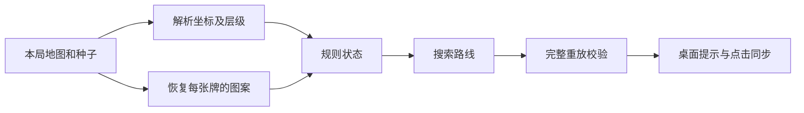

# 羊羊狩猎者：设计与现状

## 目标

在电脑版微信的《羊了个羊：星球》中，辅助玩家完成第二关。程序给出下一步并记录玩家的实际点击；玩家始终在游戏窗口中自行操作。

## 数据和求解

- 地图包含牌 ID、位置、层数、图案总量和遮挡结构。本局种子决定具体图案。`templates/` 保存不含身份信息的地图结构；用户本局的数据留在 `captures/`。
- `Board` 以已取走牌的位图和槽位图案计数建模普通点击。槽位最多容纳七张；同图案凑齐三张立即消除。
- `ToolEngine` 额外记录槽位顺序、移出区三列的堆栈，以及“移出”和“复活”的使用状态。移出道具将槽位最前方最多三张牌分别放入三列；每列只允许取回最上面一张。复活在槽位满后按同样方式移出前三张。
- 求解器搜索普通点击及允许的道具动作，并在显示路线前从初始状态完整重放。搜索耗尽预算只表示“尚未找到路线”。

## 桌面同步

- 第一关由玩家自行完成；画面检测到第二关后才开始标记和记录点击。
- 普通牌根据地图坐标映射到游戏窗口。程序监听鼠标，比较点击前后的牌面与槽位画面，成功后推进路线。
- 使用“移出”时，从道具前后的画面变化尝试定位移出区三列。玩家点击该区域后，程序检查牌面或槽位是否变化；定位失败时仍尝试从区域点击和画面变化识别。
- “复活”操作目前由玩家手动确认。识别错误时可以撤销、补记或重新规划。

## 已验证与限制

已在一局 225 张牌的第二关上按求出的道具路线实际通关。规则模型的单元测试与移出区点击的模拟检查通过；移出区自动识别还需下一局真实画面验证。

实现依赖当前游戏版本的种子格式、地图模板、窗口标题和画面坐标。游戏更新后，可能需要重新解析地图或校准画面。程序只支持 Windows 桌面微信窗口，不负责自动点击游戏。
